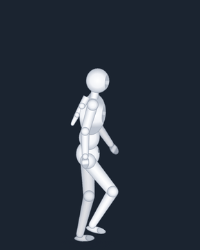
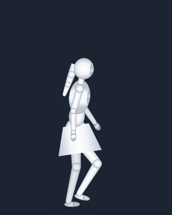
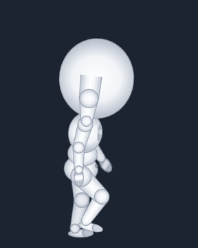
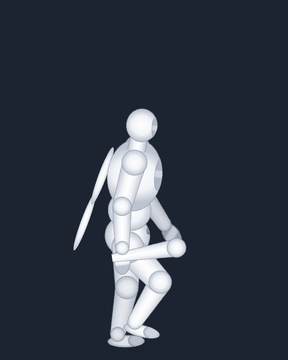
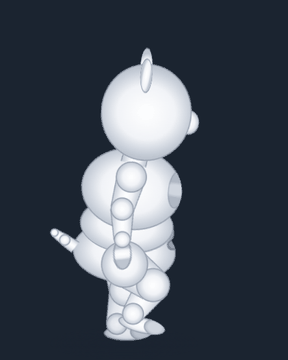
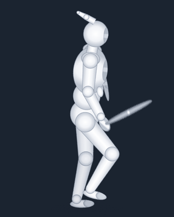
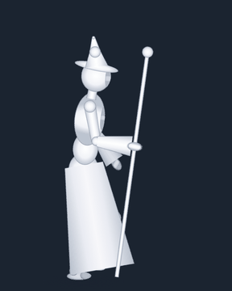
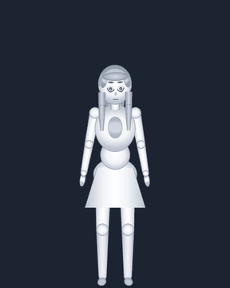

# zhuda-spine2D

讓 AI agent 從零做出 **Spine 4.2 骨骼動畫角色** 的工具包與研究紀錄。
骨架、網格權重、IK、物理、動畫都由程式產生並編譯成原生 Spine JSON / atlas / png，每一步都有可執行的閘門（數值檢查、原生截圖、極限姿勢）。

## 白模展示

八個白模，各自代表一種身體比例和配件，動作是從 3D 姿態烘出來的。這裡都在 spine-webgl 4.2 原生 runtime 裡播放，不是逐格圖。

| hero | heroine | chibi | brute |
|:-:|:-:|:-:|:-:|
|  |  |  |  |
| 標準成人＋圍巾鏈 | 窄肩寬髖、馬尾、裙錐 | 2.5 頭身，步幅按腿長縮放 | 1.5 倍肩寬、披風、棍棒 |

| mascot | knight | mage | vtuber |
|:-:|:-:|:-:|:-:|
|  |  |  |  |
| 圓身短肢、耳朵、尾巴、側背包 | 盾（8 視角）、劍、肩甲 | 尖帽、長袍、寬袖、法杖 | 正面看板，12 個即時參數＋物理頭髮 |

每個白模的原始碼、零件、換皮模板、可直接打開的預覽頁在 [`examples/whitemodels/`](examples/whitemodels/)（說明見該資料夾的 README）。
預覽頁：`examples/whitemodels/<名字>/dist/<名字>_preview.html`，下載後用瀏覽器開啟即可。

## 快速開始

```sh
python3 spk.py doctor                           # 檢查環境（Python 3.9+、Pillow、numpy、Node 18+、Playwright+Chromium）
python3 spk.py build examples/whitemodels/hero  # 重建白模 → build/001/hero.json / .atlas / .png
python3 spk.py check examples/whitemodels/hero  # 數值閘門
python3 spk.py sheet examples/whitemodels/hero --anim turntable --n 8   # 原生截圖時序表
python3 tests/selftest.py                       # 工具包自我測試
```

Agent 從 [`SKILL.md`](SKILL.md) 進入；完整的工具包說明在 [`docs/TOOLKIT_README.md`](docs/TOOLKIT_README.md)。

## 目錄

| 路徑 | 內容 |
|---|---|
| `spk.py`、`spinekit/` | CLI 與編譯器（骨架、網格、權重、約束、動畫 → Spine JSON） |
| `tools/`、`viewer/` | 原生截圖、數值掃描、預覽頁 |
| `docs/` | 流程、規則、各階段文件 |
| `examples/whitemodels/` | 八個白模（展示用） |
| `examples/shuang`、`examples/xiaoshuang` | 從設計稿到動畫的完整範例 |
| `research/` | 用真實角色做換皮與全身綁定的研究紀錄（程式與筆記） |
| `showcase/` | 上面的展示動圖 |

## 研究紀錄

[`research/`](research/) 收的是拿真實角色測試這套方法的過程：白模換皮、從設計稿直接綁定、半身虛擬主播、全身動作（跑、跳、徒手攻擊、撿東西）。
只放程式和工作日誌（`WORKLOG.md`），不放角色美術；結論和沒解決的問題都照實寫在日誌裡。

## 授權

- 工具包程式：見各檔案與 [`THIRD_PARTY.md`](THIRD_PARTY.md)。
- `node_modules/@esotericsoftware/` 是 Spine Runtimes 4.2.119，依 Spine Runtimes License Agreement 隨附；使用者整合 runtime 須自行持有 Spine Editor 授權。
